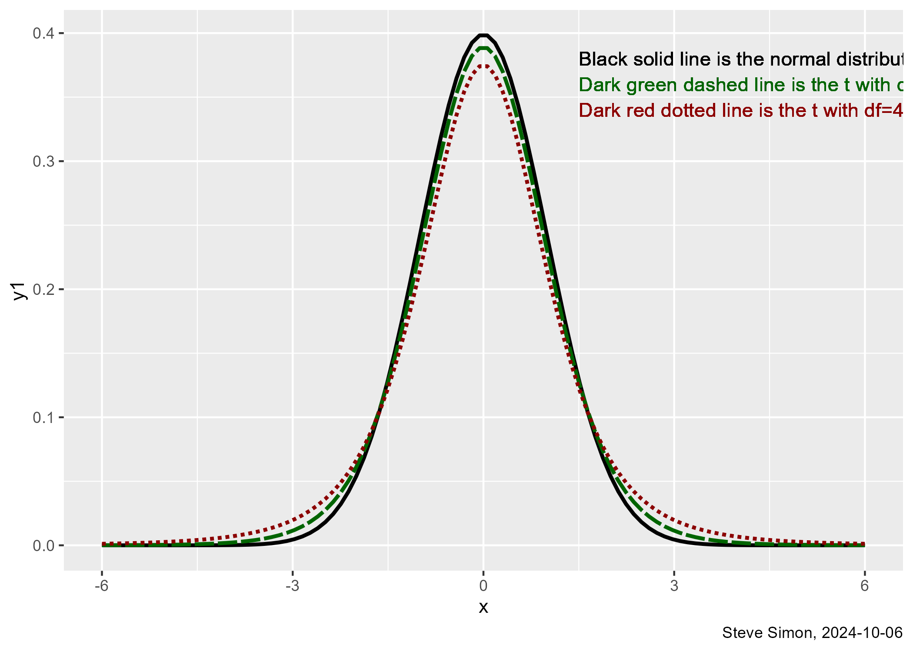
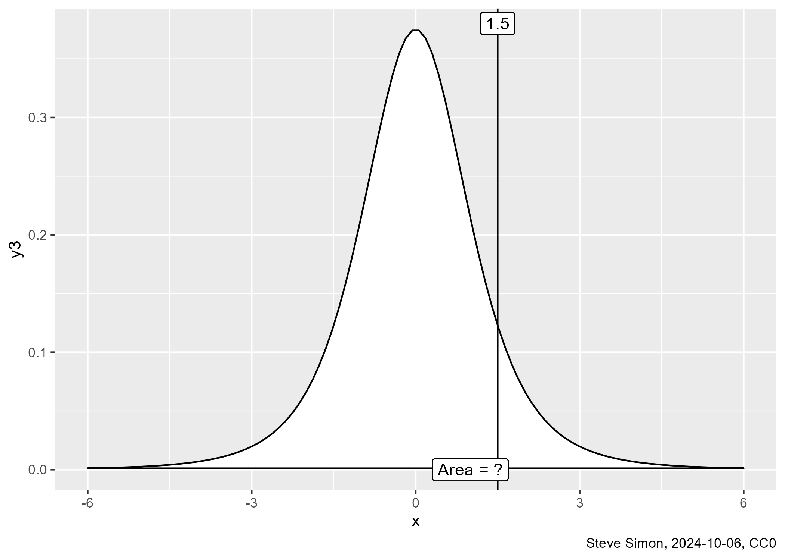
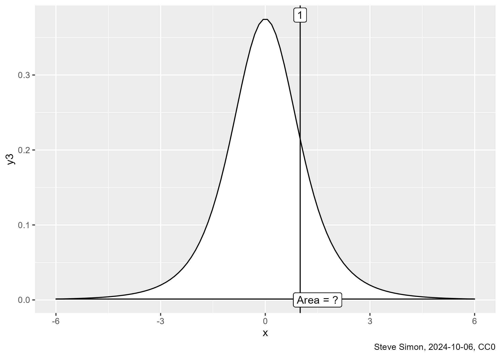
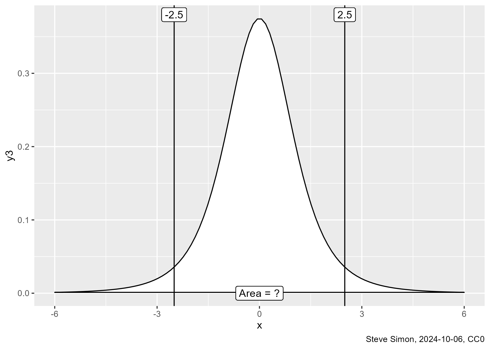
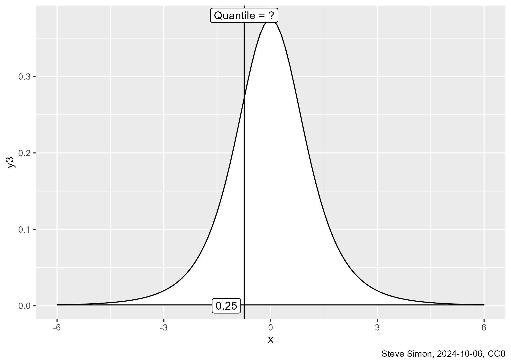

## The t distribution

-   $T=\frac{\bar{X}_1-\bar{X}_2}{se}$
    -   Variation in the numerator AND the denominator
    -   Use a t-distribution, not a normal distribution
        -   $df=n_1+n_2-2$
    
:::notes
The test statistic, T, is the ratio of the difference in sample means to the standard error. This statistic has variation both in the numerator and the denominator. This produces a statistic that is not normally distributed, but close to normal. It is the t-distribution.

The t-distribution has degrees of freedom. A large degrees of freedom means very little sampling error in the denominator. It is the total sample size ($n_1+n_2$) minus two degrees of freedom associated with the two estimated means used in the standard deviation calculation.
:::

## Comparing the t and normal distributions



:::notes
This graph compares the normal distribution to a t distribution with 10 degrees of freedom and a t distribution with 4 degrees of freedom. Both the normal and the t-distributions are symmetric. The t-distributions have a little bit less probability near zero and a bit more probability at the extremes.
:::

## P[t(4) < 1.5]

:::: {.columns}
::: {.column width="60%"}

:::
::: {.column width="40%"}
```{r}
#| label: prob-01
#| echo: true

pt(1.5, 4)
#
# Compare this
# to the normal 
# probability
#
pnorm(1.5)
```
:::
::::

::: {.notes}
The calculations of normal probabilities used the pnorm function. For the t-distribution, you should use the pt function. Specify the limit, in this case 1.5, and the degrees of freedom. The probability that a t-distribution with 4 degrees of freedom is less than 1.5 is a bit less than 90%. This is slightly different from the probability you would get with the normal distribution.
:::

## P[t(4) > 1]

:::: {.columns}
::: {.column width="60%"}

:::
::: {.column width="40%"}
```{r}
#| label: prob-02
#| echo: true

1-pt(1, 4)
```
:::
::::

::: {.notes}
To get the probability or area to the right, subtract the pt function from 1. The probability that a t-distribution with 4 degrees of freedom is greater than 1 is about 19%.
:::


## P[-2.5 < t(4) < 2.5]

:::: {.columns}
::: {.column width="60%"}

:::
::: {.column width="40%"}
```{r}
#| label: prob-03
#| echo: true

pt(2.5, 4)-pt(-2.5, 4)
```
:::
::::

::: {.notes}
To get the probability of being between two numbers, compute the difference between pt functions. The probability that a t-distribution with 4 degrees of freedom is between plus or minus 2.5 is about 93%.
:::

## 25th percentile of t(4)

:::: {.columns}
::: {.column width="60%"}

:::
::: {.column width="40%"}
```{r}
#| label: prob-04
#| echo: true

qt(0.25, 4)
```
:::
::::

::: {.notes}
Use the quantile function, qt, to calculate any quantile of the t-distribution. The lower quartle (25th percentile) of a t-distribution with 4 degrees of freedom is -0.74. About one-fourth of the probability is less than this value and about three=fourths of the probability is greater than this value.
:::