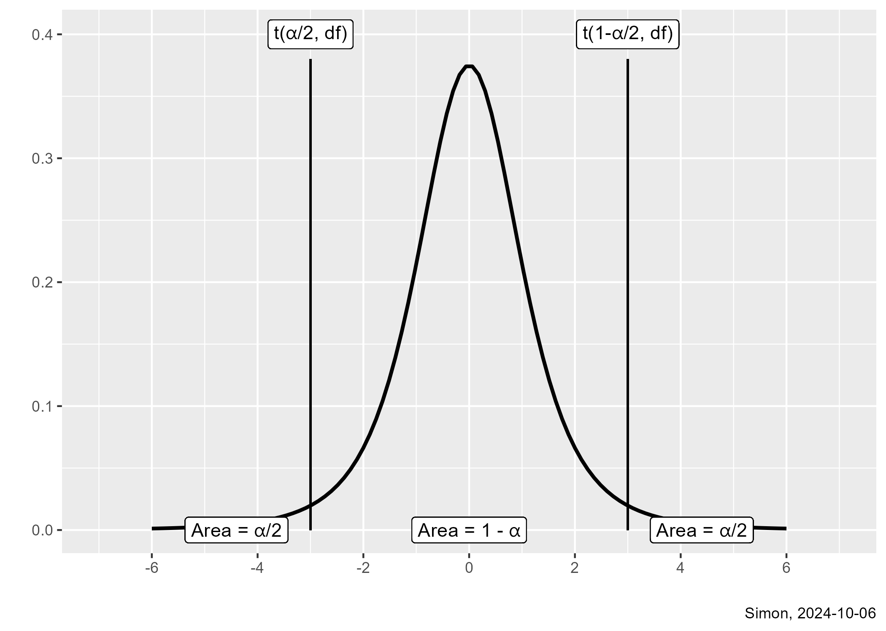
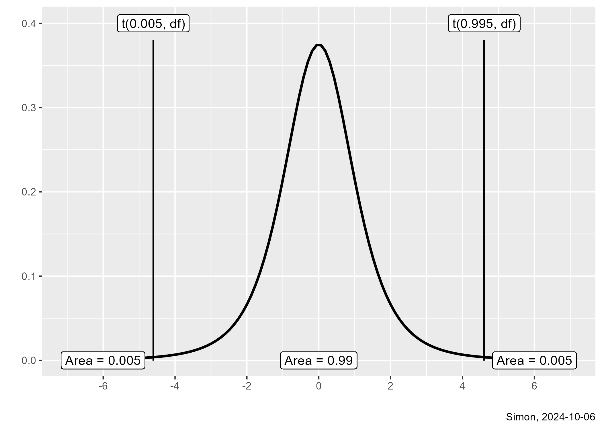
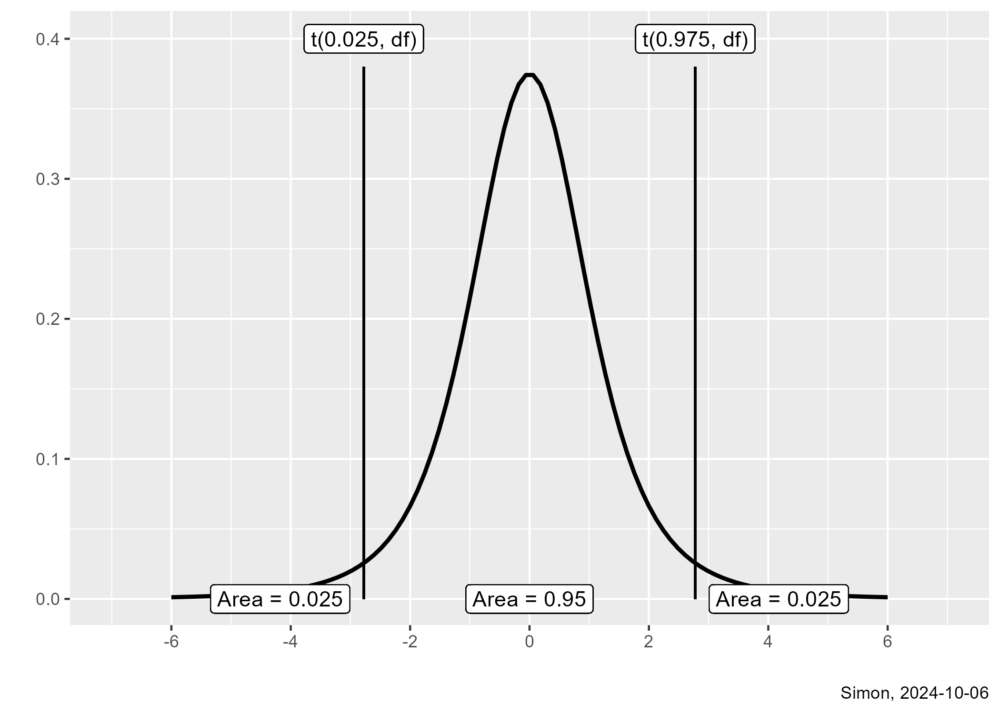

## Type I and Type II errors

-   Type I error, Rejecting the null hypothesis when the null hypothesis is true
    -   $\alpha$ is the probability of a Type I error
-   Type II error, Accepting the null hypothesis when the null hypothesis is false
    -   $\beta$ is the probability of a Type II error
    -   Power = 1 - $\beta$
    
::: {.notes}
Let's review the definition of Type I and Type II error rates.
:::

## Critical values, 1

-   $H_0:\ \mu_1 - \mu_2 = 0$
-   $H_1:\ \mu_1 - \mu_2 \ne 0$
    -   $T=\frac{\bar{X}_1-\bar{X}_2}{se}$
    -   Accept $H_0$ if $t(\alpha/2, df) < T < t(1-\alpha/2, df)$

::: {.notes}
The formal test of hypothesis looks at whether the test statistic T is close to zero. Close means that it falls between the $\alpha/2$ and $1-\alpha/2$ percentiles of a t distribution with n1 + n2 -2 degrees of freedom.

The standard error is, in general terms, an estimated amount of variation for statistics computed from a sample. In this case, the standard error is an estimate of how much variation to expect when you compute the difference between two sample means.

You use the t-distribution because there is randomness in the test statistic in both the numerator and the denominator. The numerator uses means calculated  from the sample. I'm not showing the formula for the standard error here, but it uses standard deviations calculated from the sample. 
:::
  
## Critical values, 2



::: {.notes}
Here is a graphical display of the critical values. Close to zero is equivalent to having a probability of 1-alpha in the middle of the t-distribution. A probability of 1-alpha in the middle and alpha/2 plus alpha/2 in the extremes is equivalent to a Type I error rate of alpha.

You want alpha to be small. What are some possible values for alpha?
:::

## Critical values, 3


::: {.notes}
Here are some critical values that place 90% of the probability in the middle and 5% at either extreme. This set of critical values would produce a Type I error rate of 90%.
:::

## Critical values, 4



::: {.notes}
Here is a set of critical values that places 99% of the probability in the middle and 1% at the extremes. These critical values would produce a Type I error rate of 1%.
:::

## Critical values, 5



::: {.notes}
Here is a set of critical values that places 95% of the probability in the middle, 2.5% on the low end, and 2.5% on the high end. These critical values would produce a Type I error rate of 5%.
:::

## Which critical values should you choose?

-   If a Type I error is far more serious than a Type II error,
    -   Use t(0.005, df) and t(0.995)
    -   P[Type I error] = 0.01 (conservative)
-   If a Type II error is far more serious than a Type I error,
    -   Use t(0.05, df) and t(0.95)
    -   P[Type I error] = 0.10 (liberal)
-   If you want to avoid controversy
    -   Use t(0.025, df) and t(0.975)
    -   P[Type I error] = 0.05
    -   Lemming school of research

::: {.notes}
Which critical values should you choose? This is an important question, and one that is often ignored.

There are settings where a Type I error rate is very serious and a Type II error rate is less serious. Perhaps there is a large financial burden associated with rejecting the null hypothesis, and a false positive finding would lead to a lot of wasted money. In such a case, having a small Type I error rate, 0.01, may be attractive. For these settings, use critical values of t(0.005, df) and t(0.995, df).

You will often see the word "conservative" applied to tests that have a very small Type I error rate. This is not at all related to politics, though.

The reverse may be true. Perhaps rejecting the null hypothesis leads to a small financial burden, but accepting the null hypothesis is where you see a large financial burden. In such a case, you may tolerate a larger Type I error rate, 0.10. For these settings, use critical values of t(0.05, df) and t(0.95, df).

In contrast to the conservative Type I error rate, a larger value for the Type I error rate like 10% is sometimes described as "liberal". Again, there is no political implications in the use of this word.

To be honest, most researchers do not think too hard about the financial implications of a Type I error rate. They just go along with what everyone else does and set the probability of a Type I error rate to 0.05. This leads to critical values of t(0.025, df) and t(0.975).

I call this the Lemming school of research. At one time or another, a parent will try to discourage their children from bowing to peer pressure with the warning "If all your friends jumped off a cliff, would you jump off also?"
:::

## P-value

-   p-value = $2 P[t(n_1+n_2-2) > |T|]$
    -   Probability of sample results or results more extreme
    -   Accept $H_0$ if p-value > $\alpha$
-   Why the 2?
    -   Measuring extremity in either direction
    
::: {.notes}
The p-value is a simple way to test hypotheses that removes the need to calculate critical values. The p-value is quite ubiquitous. It is by far the most commonly computed statistics in research. It is also quite controversial. Some researchers have called for an outright ban on p-values. More have called for the research community to rely less on p-values and more on other statistics like the confidence interval.

Don't worry so much about the controversies now. 

There are two big advantages to the p-value. First, it is easy to apply. A small p-value (less than alpha) means that you should reject the null hypothesis. A large p-value (greater than alpha) means that you should accept the null hypothesis.

Second, when you report the p-value, someone with a statistically conservative outlook can see if the p-value is less than 0.01. Someone with a statistically liberal outlook can see if the p-value is less than 0.10. 
:::

## Postural sway data, 1

```{r}
#| label: sway-summary
#| message: false
#| warning: false

library(tidyverse)

load("../data/module08.RData")

sway |>
  group_by(Age) |>
  summarize(
    fb_mn=mean(FBSway),
    fb_sd=sd(FBSway),
    n=n())
```

::: {.notes}
Here are some descriptive statistics from a small study looking at postural sway. Patients stood on a force plate that could measure how much the patient swayed front-to-back and side-to-side. A large amount of sway could mean problems with loss of balance and falls. The sample size was small, nine elderly patients and eight young patients. There does seem to be more front to back sway in the elderly patients with an average of 26 compared to 18. But the sample size is small and there is a fair amount of variation in the patients, with standard deviations of 9.8 and 4.1.

Let's show some of the calculations that go into testing the hypothesis that the population mean front-to-back sway is the same for both groups.
:::

## Postural sway data, 2

```{r sp}
sp <- sqrt((9*9.77^2+8*4.09^2)/(9+8))
```

-   Calculate pooled standard deviation
    -   $S_p$ = $\sqrt{\frac{n_1\ S_1^2\ +\ n_2\ S_2^2}{n_1\ +\ n_2}}$
    -   $S_p$ =$\sqrt{\frac{9\ (9.77)^2\ +\ 8\ (4.09)^2}{9\ +\ 8}}$
    -   $S_p$ = `r round(sp, 2)`

::: {.notes}
The first step is to compute a pooled standard deviation. The pooled standard deviation is a composite of the two individual standard deviations. It will always lie somewhere between the two individual standard deviations. In this example, you need to square the two standard deviations, multiply each by their respective sample sizes, divide by the total sample size and then square root the whole thing.

Phew! A lot of work and we are just getting started.
:::

## Postural sway data, 3

```{r se}
se <- sp*sqrt(1/9+1/8)
```

-   Calculate standard error
    -   se = $S_p \sqrt{\frac{1}{n_1}+\frac{1}{n_2}}$
    -   se = $7.64 \sqrt{\frac{1}{9}+\frac{1}{8}}$
    -   se = `r round(se, 2)`

::: {.notes}
Next you need to compute the standard error. The standard error is, in general terms, a measure of variation for a sample statistic. In this case, it is a measure of variation for the difference between the two means. This formula is also a bit messy, but notice that standard error is in some sense inversely related to the two sample sizes. The larger the sample sizes, the smaller the standard error. This should make sense. Larger sample sizes lead to greater precision.
:::

## Postural sway data, 4

```{r t}
t <- (26.3-18.1)/3.72
```

-   Calculate T
    -   T = $\frac{\bar{X}_1-\bar{X}_2}{se}$
    -   T = $\frac{26.3-18.1}{3.72}$
    -   T = `r round(t, 2)`

::: {.notes}
Now compute the test statistic, which is the difference in the sample means divided by the standard error. If this test statistic is close to zero, that implies that the difference that you are seeing between the two sample means can easily be explained by sampling error. When the test statistic is large negative or large positive, the difference between sampling means cannot not be explained away by sampling error.

The value that you get, 2.2, is borderline. It is not too close to zero, but it is not too far away either.
:::

## Postural sway data, 5

-   Calculate degrees of freedom
    -    df = n1 + n2 - 2
-   Calculate critical values
    -    t(0.025, 15) = qt(0.025, 15) = `r round(qt(0.025, 15), 2)`
    -    t(0.975, 15) = qt(0.975, 15) = `r round(qt(0.975, 15), 2)`    
    -    Since T is outside the two critical values, reject $H_0$

::: {.notes}
You calculate the degrees of freedom by adding up the two sample sizes, but you have to subtract two. You lose two degrees of freedom because you are estimating variation around two different sample means. In this example, because the sample sizes are small, the degrees of freedom is ony 15.

The critical values are the values that delineate what it means to be close to zero. The 0.025 quantile and the 0.975 quantile of the t-distribution with 15 degrees of freedom are plus or minus 2.13.

The test statistic, 2.2 is outside of the two critical values, making the test statistic far away from zero, but just barely. This means that you should reject the null hypothesis and conclude that the front-to-back postural sway in the population of elderly patients is larger than the postural sway in the population of young patients.
:::
    
## Postural sway data, 6

```{r p-v}
p_value <- 2*(1-pt(2.2, 15))
```

-   Calculate p-value
    -    p.value = $P[t(n_1+n_2-2) > |T|]$
    -    p.value = $2\ P[t(15) > |2.2|]$ = 2*(1-pt(2.2, 15)) = `r round(p_value, 3)`
    
::: {.notes}
You could also test the hypothesis about the two population means using a p-value. In this case, the p-value is twice the probability that a t-distribution with 15 degrees of freedom is larger than the absolute value of the test statistic. You use the pt function to calculate probabilities for the t-distribution. It is one minus because you are looking at a greater than probability and you double it because you are interested in both very large positive and very large negative test statistics.
:::
## Postural sway data, 7

```{r t-test-sway}
m1 <- t.test(
  FBSway ~ Age, 
  data=sway,
  alternative="two.sided",
  var.equal=TRUE)
m1
```

::: {.notes}
Well, I don't know about you, but I am exhausted after all this work. There was nothing terribly complex about this. A few additions, and subtractions, a few fractions, and toss in a couple of square roots. It's all more tedious than it is difficult. The only hard part is remembering all the formulas.

The good news is that while I suffered doing these calculations, you don't have to suffer. You can get R to do all the work for you. Here is what R presents when you use the t.test function.

At the bottom are the two sample means. Above that is the 95% confidence interval, which you encounter later in today's lecture. Near the top is the test statistic, 2.2, the degrees of freedom, 15, and the p-value, 0.044. Notice that I am rounding in my interpretations.

Because the p-value is small, less than 0.05, you would reject the null hypothesis. Let's interpret this result in the next slide.

## A proper interpretation

-   $H_0:\ \mu_1 - \mu_2 = 0$
-   $H_1:\ \mu_1 - \mu_2 \ne 0$
    -   Reject the null hypothesis and conclude that the mean front-to-back sway in the population of elderly patients is greater than the mean front-to-back sway in the population of young patients.
-   What to look for in the interpretation
    -   A statement about the population, not the sample
    -   Use of directional words
    
::: {.notes}
Remmeber that the hypothesis is a statement about the two populations, the population of elderly patients and the population of young patients. These two populations are very large, and we only have enough resources to get sample of nine in one group and eight in the other group. Even so, the difference that we saw in the sample means was larger, larger than could be accounted for by sampling error.

When you make a statement, don't say that the sample mean for one group is equal to or different from the sample mean for the other group. Your hypothesis uses Greek letters and concerns the population parameters. Notice that we use words like "mean front-to-back sway in the population of elderly patients". Also use directional words. You did reject the null hypothesis, so you know that there is statistical evidence that the two population means are not equal. But go a bit further and explain the direction of the difference. Notice the word "larger" in the interpretation. You could have also said "greater than". if you flip things around you could talk about how the mean sway is smaller in the population of young patients. 

If you accepted the null hypothesis, you would use words like "equal" of "the same as".
:::

