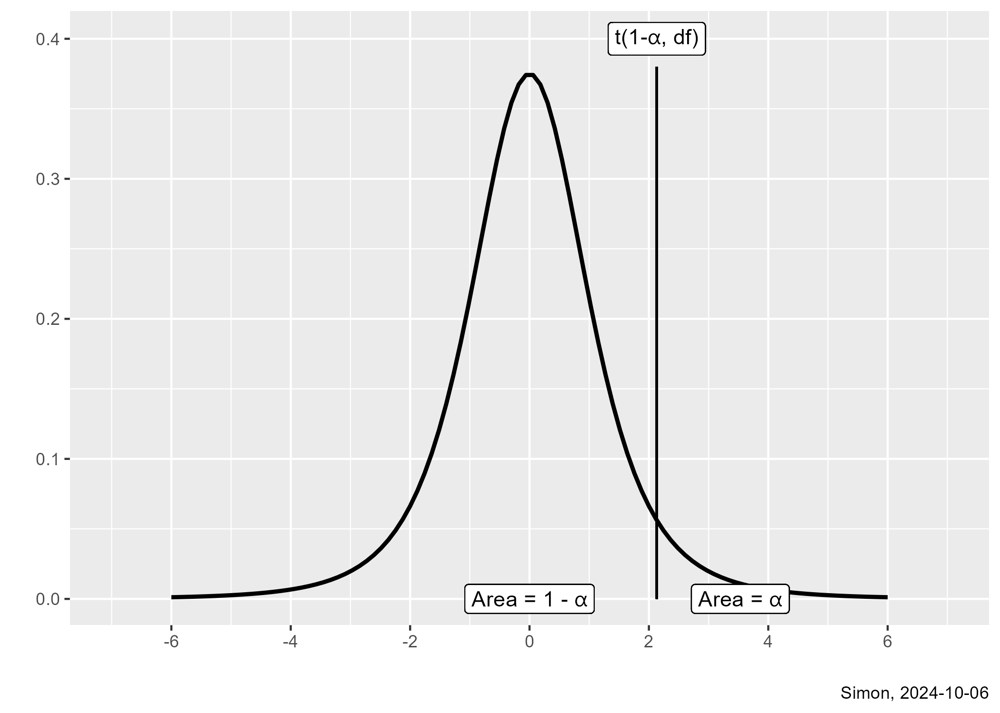
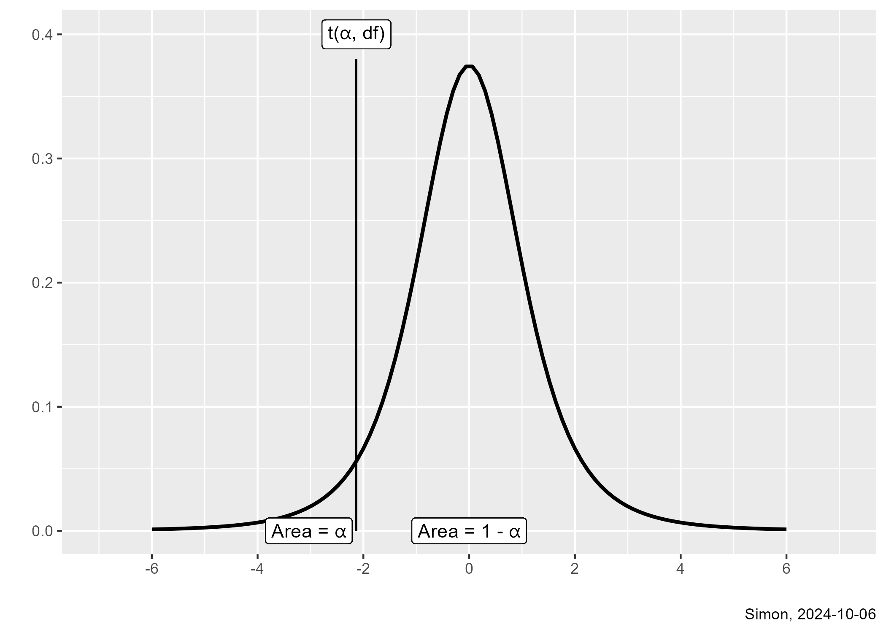

## One-tailed tests, 1

-   $H_0:\ \mu_1 - \mu_2 \le 0$
-   $H_1:\ \mu_1 - \mu_2 > 0$
    -   Accept $H_0$ if $\bar{X}_1-\bar{X}_2$ is large negative
    -   Accept $H_0$ if $\bar{X}_1-\bar{X}_2$ is close to zero
    -   Reject $H_0$ if $\bar{X}_1-\bar{X}_2$ is large positive
-   More precisely,
    -   Accept $H_0$ if $T \le t(1-\alpha, df)$
    -   Reject $H_0$ if $T \gt t(1-\alpha, df)$

:::notes
Sometimes you are only interested in changes in a positive direction. A difference only in the positive direction implies that the first population mean is larger than the second population mean. No change and changes in the negative direction are part of the null hypothesis.

If the difference in the sample, x-bar-1 minus x-bar-2 is large negative, you accept the null hypothesis. If the difference in the sample is close to zero, you accept the null hypothesis. Only if the difference in the sample, x-bar-1 minus x-bar-2 is large positive would you reject the null hypothesis.
:::

## Critical value for a one tailed test, 1
    

:::notes
The area to the right of the critical value is $\alpha$ and the area to the left is 1-$\alpha$.
:::

## One-tailed tests, 2

-   $H_0:\ \mu_1 - \mu_2 \ge 0$
-   $H_1:\ \mu_1 - \mu_2 < 0$
    -   Reject $H_0$ if $\bar{X}_1-\bar{X}_2$ is large negative
    -   Accept $H_0$ if $\bar{X}_1-\bar{X}_2$ is close to zero
    -   Accept $H_0$ if $\bar{X}_1-\bar{X}_2$ is large positive
-   More precisely,
    -   Accept $H_0$ if $T \ge t(\alpha, df)$
    -   Reject $H_0$ if $T \lt t(\alpha, df)$

:::notes
There is a second one-sided hypothesis. This tests the hypothesis that the difference is negative, or equivalently that the first population mean is smaller than the second population mean.

If the difference in the sample, x-bar-1 minus x-bar-2 is large negative, you should reject the null hypothesis. If the difference in the sample is close to zero or if it is large positive, you should accept the null hypothesis.
:::

## Critical value for the one-tailed test, 2
  

:::notes
The area to the left is $\alpha$ and the area to the right is 1-$\alpha$.
:::

## Calculation of the p-value

-   For testing $H_1:\ \mu_1 - \mu_2 \ne 0$
    -   p-value = $2 P[t(n_1+n_2-2) > |T|]$
-   For testing $H_1:\ \mu_1 - \mu_2 > 0$
    -   p-value = $P[t(n_1+n_2-2) > T]$    
-   For testing $H_1:\ \mu_1 - \mu_2 < 0$
    -   p-value = $P[t(n_1+n_2-2) < T]$        
-   For any of these hypothesis,
    -   Accept $H_0$ if p-value > $\alpha$
    
:::notes
The calculation of the p-value changes slightly if you have a one-sided hypothesis. But the decision rule is always the same, accept the null hypothesis if the p-value is large, larger than alpha.
:::

## R code for one-sided hypotheses

-   For testing $H_1:\ \mu_1 - \mu_2 \ne 0$
     -   `alternative="two-sided"`
-   For testing $H_1:\ \mu_1 - \mu_2 > 0$
    -   `alternative="greater"`
-   For testing $H_1:\ \mu_1 - \mu_2 < 0$
    -   `alternative="less"`

:::notes
The t.test function in R has an argument, alternative. The default is "two-sided". Change this to "greater" or "less" to produce the appropriate one-sided hypothesis.
:::
