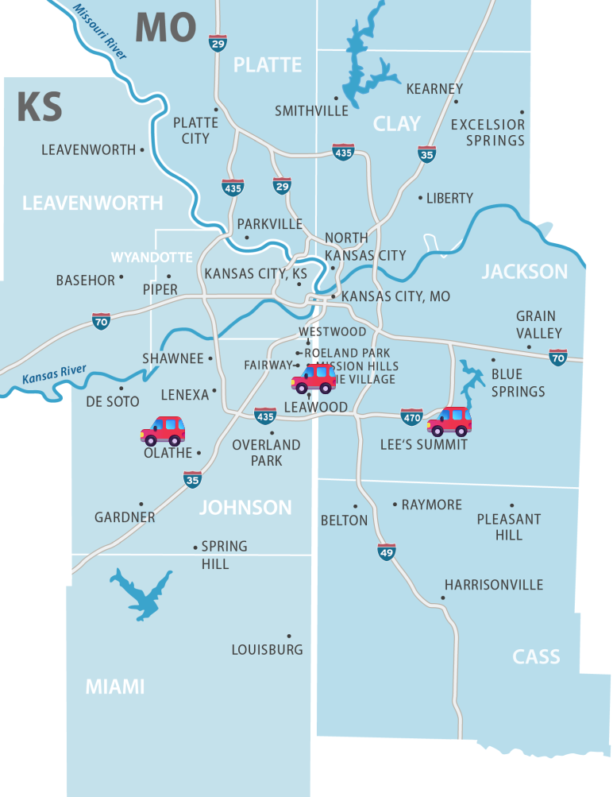

## Multiple comparisons issue

-   Type I error: rejecting the null hypothesis when the null hypothesis is true.
    -   Multiple simultaneous hypotheses increase the Type I error rate.
-   $E_1$ = Type I error for Hypothesis 1
-   $E_2$ = Type I error for Hypothesis 2
    -   $P[E_1\ \cup\ E_2]=P[E_1]+P[E_2]-P[E_1\ \cap\ E_2]$
    -   $P[E_1\ \cup\ E_2]\ \le\ P[E_1]+P[E_2]$
    -   $P[E_1\ \cup\ E_2]\ \le\ 2 \alpha$
    
::: notes
Recall that a Type I error is rejecting the null hypothesis when the null hypothesis is true. In analysis of variance, there are several types of deviations that you might want to investigate. Let's look at this from a theoretical perspective. Let's suppose there are two alternative hypotheses H1 and H2 and you will reject the null hypothesis if either one of the alterantives is true. A bit of math will show that if you have an alpha level for each of the two hypotheses, then your chance of making a Type II error almost doubles. You thought you were controlling the Type I error rate at 5% but you let the Type I error rate creep up to almost 10%.
:::

## Bonferroni adjustment

-   For m hypotheses
    -   $P[E_1\ \cup\ ...\ \cup E_m]\ \le\ m \alpha$
-   Test each hypothesis at $\alpha/m$
    -   Preserves overall Type I error rate
-   Example, 3 simultaneous hypotheses
    -   Reject H0 if p-value \< 0.05/3 or 0.0167

::: notes
For multiple hypotheses, it gets worse. With m hypotheses, your Type I error rate gets multiplied by m. Now it isn't that bad in reality, but it is close. With 3 hypotheses, a Type I error rate that holds individually at 5% can be almost as bad as 15%. With 10 hypotheses, it can be almost 50%.

The solution is to test each individual hypothesis at a smaller level. If you have three ways that the null hypothesis might be rejected. Test each at a 0.05/3 or 0.0167 Type I error rate.
:::

## Tukey post hoc tests

-   $H1\ \mu_i \ne \mu_j$ for at least one i, j
-   If you reject H0, which i,j comparisons are unequal?
    -   With k groups, there are k(k-1)/2 comparisons
-   Studentized range (Tukey test)
    -   Requires equal sample sizes per group
    -   Uses harmonic mean approximation for slightly unequal sample sizes.
        -   Do not use harmonic means if seriously different sample sizes.
-   `TukeyHSD`

::: notes
A similar approach is known as the Tukey post hoc test. This is based on a statistic known as the studentized range. The details are not important, but it helps you identify for which values of i and j, the groups differ. And even though there are k (k-1)/2 comparisons, the Tukey post hoc test adjusts the individual Type I error rates so that the overall Type I error rate is still less than alpha.
:::

## Tukey post hoc test for k=3

-   $H_1:\ \mu_i \ne \mu_j$ for some i, j 
-   There are 3 sub-hypotheses
    -   $H_{1a}:\ \mu_1 \ne \mu_2$ and/or
    -   $H_{1b}:\ \mu_1 \ne \mu_3$ and/or
    -   $H_{1c}:\ \mu_2 \ne \mu_3$
        -   Does the confidence interval exclude zero
        -   Is the adjusted p-value less than alpha?
        
::: {.notes}
If there are three groups, the Tukey post hoc test examines three sub-hypotheses: mu1 not equal to mu2, mu1 not equal to mu3, and/or mu2 not equal to mu3.

If the confidence interval for mu1-mu2 excludes zero, then you would conclude that mu1 is not equal to mu2. Likewise if the confidence interval for mu1-mu3 excludes zero, then you would conclude that mu1 is not equal to mu3. If the confidence interval for mu2-mu3 excludes zero, then you would claim that mu2 is not equal to mu3.

Equivalently, you could look at the adjusted p-value. If the adjusted p-value is less than alpha for a particular pair, conclude that the population means for that pair are different.
:::

## Tukey post hoc test for k=4

-   $H_1:\ \mu_i \ne \mu_j$ for some i, j 
-   There are 6 sub-hypotheses
    -   $H_{1a}:\ \mu_1 \ne \mu_2$
    -   $H_{1b}:\ \mu_1 \ne \mu_3$
    -   $H_{1c}:\ \mu_1 \ne \mu_4$
    -   $H_{1d}:\ \mu_2 \ne \mu_3$
    -   $H_{1e}:\ \mu_2 \ne \mu_4$
    -   $H_{1f}:\ \mu_3 \ne \mu_4$

::: {.notes}
If there are four groups, then there are six possible pairwise comparisons. Compute six different confidence intervals and then see which ones include or exclude the value of zero.
:::

## Alternatives to Tukey post hoc tests, 1

-   Bonferroni adjustment
    -   Works for unequal sample sizes per group
    -   Works for unequal variances
-   Dunnett's test
    -   Treatment versus multiple controls
-   Scheffe's test
    -   Works for complex comparison
        -   Example $\mu_1\ vs.\ \frac{\mu_2+\mu_3+\mu_4}{3}$
        
::: notes
There are several good alternatives to the Tukey post hoc test. You won't have to run any of these in your programming assignment, but it helps to mention their names in case you see reference to them in a published research paper.

The Bonferroni adjustment, mentioned earlier is not quite as good as the Tukey post hoc test, but it still works even with unequal sample sizes and even with unequal variances.

The Dunnett's test is helpful when you have multiple treatment and you want to compare each treatment to a control group, but you are not intersted in comparisons within each treatment. In this setting, you get a bit more precision and power with Dunnett's test compared to the Tukey post hoc test.

Finally there is Scheffe's test which works for more complex comparisons such as whether the first group mean differs from an average of the second, third, and fourth group means.
:::

## Controversies over Tukey/Bonferroni adjustment

-   Criticisms that extend beyond one factor analysis of variance.
-   Increases Type II errors
-   Impractical for large values of m

::: notes
Although most researchers like using a Tukey or Bonferroni adjustment in analysis of variance, there is a vocal minority who argue that you should not use them, either in one factor analysis of variance or in more complex settings. These researchers suggest that no adjustment is better than Tukey or Bonferroni adjustments because while Tukey and Bonferroni do succeed in controlling the Type I error rate, they pay a high price (too high a price in some people's minds) in an increase in the Type II error rates.

The other problem is that these adjustments are impractical for very large numbers of comparisons, such as you might see in many genomics studies.

There is something to be said for these critiques, but you will probably have less resistance in any peer review of your work if you do try to control the Type I error rate with Tukey or Bonferroni.
:::

## Ambiguities in Tukey post hoc test results

-   One possible outcome
    -   Conclude that $\mu_1\ =\ \mu_2$
    -   Conclude that $\mu_2\ =\ \mu_3$
    -   Conclude that $\mu_1\ \ne\ \mu_3$    
    
::: {.notes}
When you have three or more groups, the results of your Tukey post hoc tests can sometimes be ambiguous. You might, for example, conclude that mu1 equals mu2 becaose the confidence interval for mu1-mu2 includes the value of zero. And you might also conclude that mu2 dquals mu3 because the confidence interval for mu2 minus mu3 includes the value of zero.

But, it could turn out that you would have the confidence interval for mu1-mu3 excluding the value of zero which would lead you to conclude that mu1 is not equal to mu3.

How could you have mu1 equal to mu2 and mu2 equal to mu3 but not have mu1 equal to mu3?

It turns out thatuse of a sample means that you make statements about whether xbar1-xbar2, xbar2-xbar3, and xbar1-xbar3 are close to zero or not. And depending on where the means lie, it is possible for xbar1 to be close to xbar2, xbar2 be close to xbar3 but xbar1 NOT be close to xbar3.
:::

## Geography analogy

::: {.notes}
Here's a map that illsutrates this. Steve Simon lives in Leawood. That's the middle car on this map. His son, Nick, used to live with him, but has moved to his own place in Lee's Summit. That's the easternmost car on this map. Nick gets his car serviced in Olathe. That's the westernmost car on the map.

Now Leawood and Olathe are close to each other. When Nick lived in Leawood, he was close to Olathe. When he moved to Lee's summit, he was still close to Steve's home in Leawood, but now he was far away from his car repair shop in Olathe.

So Olathe and Leawood are cose. Leawood and Lee's Summi are close. That does not mean that Olathe and Lee's Summit are close.

That's an analogy to the unexpected findings that you will see at times with the Tukey post hoc test.
:::