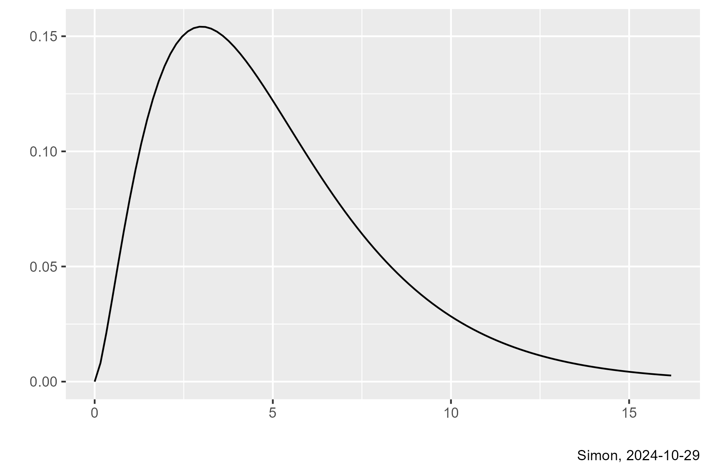

## The Chi-squared distribution

-   Often denoted as $\chi^2_{df}$
-   Has a single parameter, degrees of freedom
    -   Never negative
    -   Skewed right
    -   Mean equals degrees of freedom
-   Calculations in R
    -   pchisq(x, df) = $P[\chi^2_{df} < x]$
    -   qchisq(p, df) = $p^{th}$ quantile, $\chi^2_{df, p}$
    
## The Chi-squared distribution

:::notes
This is a graph of the Chi-squared distribution with 5 degrees of freedom. 

To review, you've seen graphs of the t-distribution. This is a symmetric distribution centered around zero. THe t-distribution is used You compare the t-test to the t-distribution. If the t-test is close to zero, you accept the null hypothesis. You also use the t-distribution to compute confidence intervals for mu1-mu2, the population means of the two groups.

You've also seen the F-distribution. This is a skewed distribution bounded below by zero and centered around the value of 1. It is used in the analysis of variance table. You compare the F-test to the F-distribution. If the F-statistic is close to 1, you accept the null hypothesis. If it is a lot larger than 1, you reject the null hypothesis

Now, we introduce a third distribution, the chi-squared distribution. It is skewed and centered around the degrees of freedom. You compared a chi-squared-test to the chi-squared distribution. If the test is close to the degrees of freedom, you accept the null hypothesis. if the test is a lot larger than the degrees of freedom, you reject the null hypothesis.

This can be a bit much to remember. So many people rely on the p-value. The p-vale for the t-test, for the F-test, and the chi-squared-test all have the same decision rule. Accept the null hypothesis if the p-value is large. Reject the null hypothesis if the p-value is small.
:::

## Decision rules

-   T (t-test)
    -   Copmpare to the t-disctirbution
    -   Accept H0 if the t-test is close to zero
-   F (F-test)
    -   Compare to the F distribution
    -   Accept HO if the F-test is close to 1
-   X2 (chi-squared-test)
    -   Compare to the chi-squared distribution
    -   Accept HO if the chi-squared test is close to the degrees of freedom
    
::: notes
To review, you've seen graphs of the t-distribution. This is a symmetric distribution centered around zero. THe t-distribution is used You compare the t-test to the t-distribution. If the t-test is close to zero, you accept the null hypothesis. You also use the t-distribution to compute confidence intervals for mu1-mu2, the population means of the two groups.

You've also seen the F-distribution. This is a skewed distribution bounded below by zero and centered around the value of 1. It is used in the analysis of variance table. You compare the F-test to the F-distribution. If the F-statistic is close to 1, you accept the null hypothesis. If it is a lot larger than 1, you reject the null hypothesis

Now, we introduce a third distribution, the chi-squared distribution. It is skewed and centered around the degrees of freedom. You compared a chi-squared-test to the chi-squared distribution. If the test is close to the degrees of freedom, you accept the null hypothesis. if the test is a lot larger than the degrees of freedom, you reject the null hypothesis.
:::

## P-value is easier to remember

-   Same diecision rule for any test
    -   Accept H0 if the p-value is large
    -   Reject H0 if the p-value is small
    
::: notes
This can be a bit much to remember. So many people rely on the p-value. The p-vale for the t-test, for the F-test, and the chi-squared-test all have the same decision rule. Accept the null hypothesis if the p-value is large. Reject the null hypothesis if the p-value is small.
:::
    
## Computing the Kruskal-Wallis test

-   Rank the observations, $R(X_{ij})$
    -   1 for smallest, 2 for second smallest, etc.
    -   Compute the average rank in each group, $\bar{R}_i$
    -   Compute the overall rank, $\bar{R}$
    -   T = $(N-1)\frac{\Sigma n_i(\bar{R}_i - \bar{R})^2}{\Sigma \Sigma(R(X_{ij})-\bar{R})^2}$

:::notes
The Kruskal-Wallis test is similar to the Mann-Whitney-Wilcoxon test. You rank the data from low to high, calculate an average rank in each group. Look at how much deviation the group rank averages are from the overall rank averages.
:::
  
## Decision rule for Kruskal-Wallis test, 1

-   Accept $H_0$ if T <- $\chi^2_{df, 1-\alpha}$
    -   df = k-1
-   Accept $H_0$ if p-value > $\alpha$
    -   p-value = $P[\chi^2_{df} > T]$
    
## Decision rule for Kruskal-Wallis test, 1

-   Null hypothesis is difficult to define
    -   Does not involve population means
    -   Some claim involvement of population medians
    -   Stochastic dominance
        -   $P[X_{aj} > X_{bj}] > 0.5$ for some a and b.
        
::: notes
There is a technical issue with the Kruskal-Wallis test and nonparametric tests in general. Strictly speaking, they are not really tests of populations means. Some people describe the hypothesis in terms of population medians. Others talk about stochastic dominance. This is a distinction that some people prefer to sidestep, but others can get fussy about it.

If you are working with someone who is a stickler for details, use the concept of stochastic dominance. If they are not sticklers, just talk vaguely about one group possibly being "larger" in some sense than another group.
:::

## Assumptions of the Kruskal-Wallis test

-   Homogeneity
-   Independence
    -   Assessed qualitatively
-   Normality is not an assumption

::: notes
While normality is not an assumption of the Kruskal-Wallis test, you still have to worry about whether the data is homogenous and whether the observations are independent of one another. The independence assumption is usually assess qualitatively.
:::
    
## Advantages and disadvantages of Kruskal-Wallis test

-   Advantages
    -   No need for normality assumption
    -   Still requires homogeneity and independence
    -   Not influenced by outliers
-   Disadvantages
    -   Difficult to get confidence intervals

::: notes
The Kruskal-Wallis test has fewer assumptions and is not affected by outliers. An extreme value is still going to have a reasonable rank.

A big disadvantage of Kruskal-Wallis and other tests based on ranks is that it is difficult to compute confidence intervals. It can be done, but it is tedious. It is also unclear exactly what population parameters the confidence intervals are for.
:::
