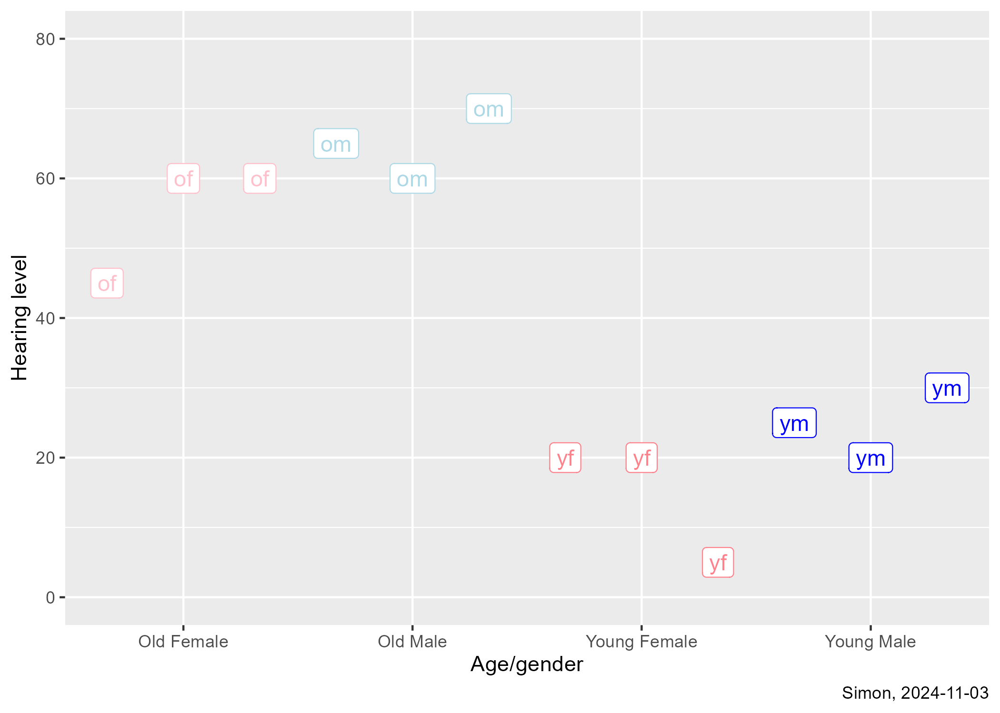
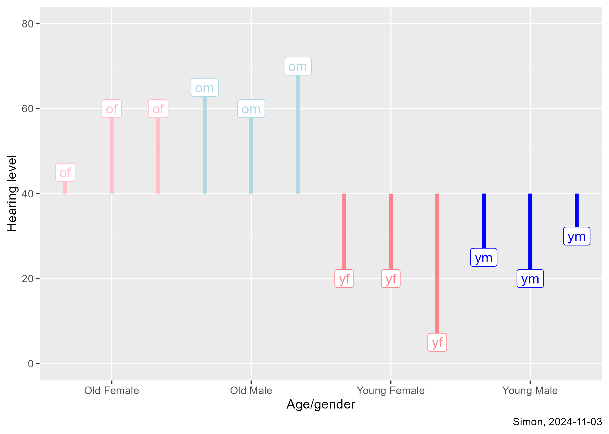
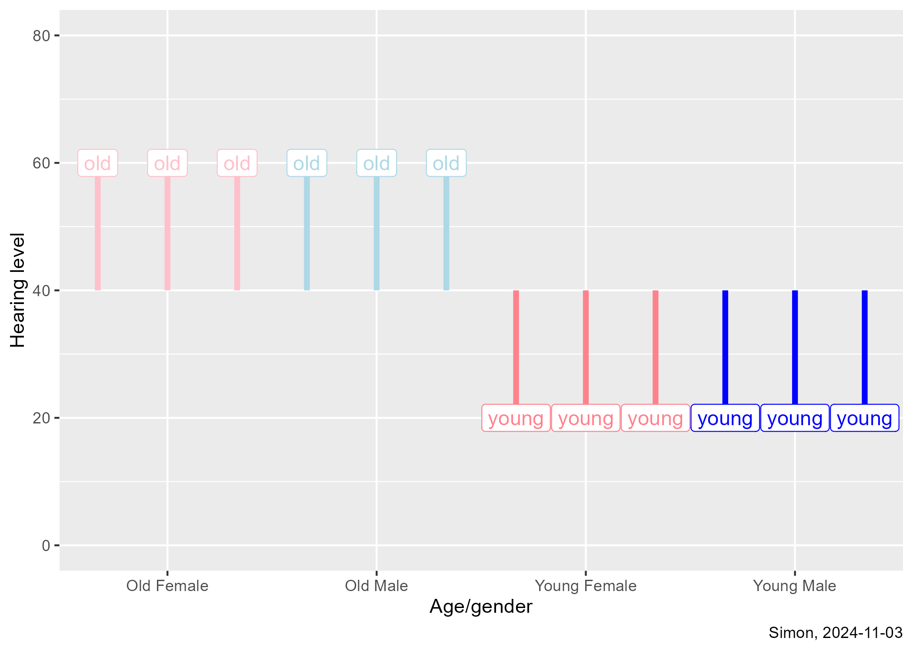
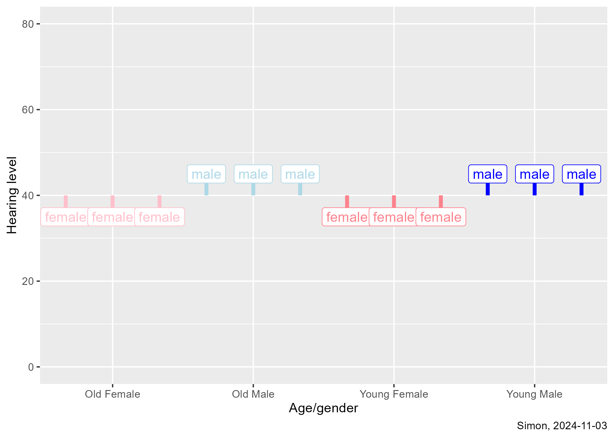

```{r}
#| label: b1-12-02-setup
#| message: false
#| warning: false

library(broom)
library(tidyverse)
```

## Hypothetical hearing loss data

```{r}
#| label: b1-12-02-listing

hearing <- read_csv(
  file="../data/hearing.csv",
  col_names=TRUE,
  col_types="ncccn")

hearing |>
  select(
    age,
    gender,
    code,
    db)
```

## Create indicator variables

```{r}
#| label: b1-12-02-indicators

hearing |>
  mutate(i_young=as.numeric(age=="young")) |>
  mutate(i_male=as.numeric(gender=="male")) |>
  select(
    age,
    gender,
    code,
    i_young,
    i_male,
    db)
```

:::notes
You need k-1 indicators for a categorical predictor that has k levels. In this simple example, that just means one indicator for age and one indicator for gender.
:::

## Means by age and gender

```{r}
#| label: means

hearing |>
  group_by(age, gender) |>
  summarize(cell_mean=mean(db))

hearing |>
  group_by(age) |>
  summarize(age_mean=mean(db))

hearing |>
  group_by(gender) |>
  summarize(gender_mean=mean(db))
```
  
## Two factor analysis of variance using aov

```{r}
#| label: b1-12-02-lm-1

m1 <-lm(db ~ age + gender, data=hearing)
anova(m1)
```

:::notes
Here is the analysis of variance table using aov.
:::


## Two factor analysis of variance using linear regression, 2

```{r}
#| label: b1-12-02-lm-2
#| echo: true
tidy(m1)
```

:::notes
The intercept is the estimated db when both indicator variables equal zero. The first indicator, i_age, is the estimated average change in db when moving from female to male. The second indicator, i_gender, is the estimated average change in db when moving from old to young.
:::

## Graphical display of the data



## Computation of SS(total)




## Computation of SS(age)



## Computation of SS(gender)


