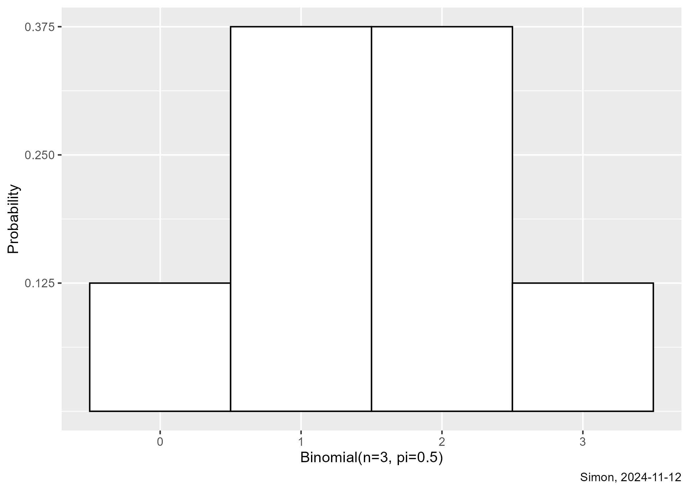
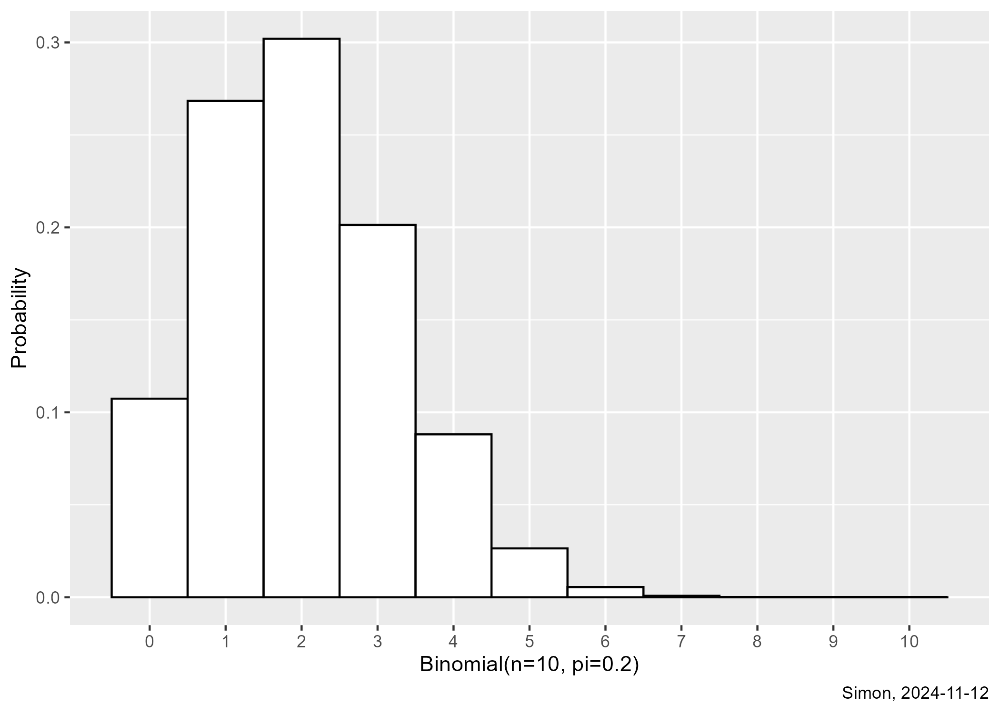
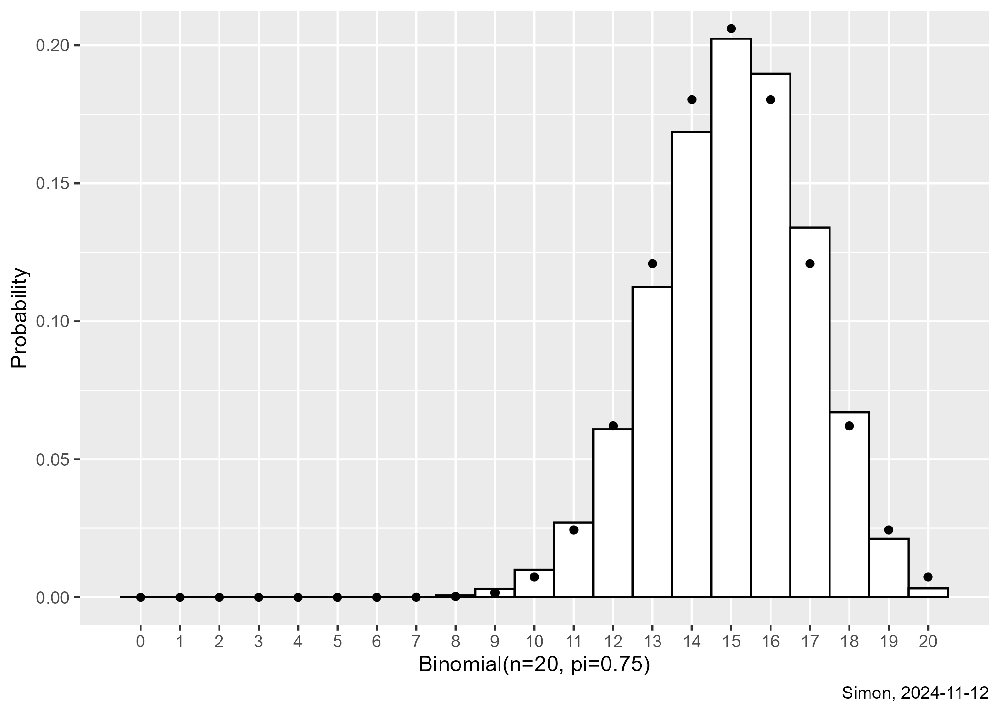

## The binomial distribution

-   You have n trials of an "experiment"
-   Two outcomes, "success" or "failure"
-   $\pi$ is probability of success
-   Each trial is independent

## Example, creating a family of three children, 1

-   You have 3 trials (pregnancies)
-   Two outcomes, girl (success) or boy (failure)
-   $\pi$ = 0.5 is probability of success
-   Each child is independent

## Example, creating a family of three children, 2

-   Eight possible outcomes
    -   X=0, BBB
    -   X=1, BBG, BGB, GBB
    -   X=2, BGG, GBG, GGB
    -   X=3, GGG
    
## Example, creating a family of three children, 3

## Example, Binomial(n=10, pi=0.2)

## Example, Binomial(n=20, pi=0.75)

## Normal approximation to binomial distribution

::: {.notes}
If the sample size is large enough and the probability is not too close to 0 or 1, the binomial probabilities can be approximated by normal probabilities. This can be a big time saver for very large sample sizes.

The informal rule of thumb is that the normal approximation works well if n*p and n*(1-p) are both greater than 5.

In this example, n*p is 15 and n*(1-p) is 15, which is big enough, just barely. The dots represent what the normal probability curve would look like at each bar midpoint.
:::
## Two proportions model, 1

-   Scenario 1
    -   $X_1$ is a random binomial($n_1, \pi_1$)
    -   $X_2$ is a random binomial($n_2, \pi_2$)
    -   $X_1$ and $X_2$ are independent

## Two proportions model, 2

-   Scenario 2
    -   Sample $X_{11}, X_{12}, ..., X_{1n_1}$
    -   Sample $X_{21}, X_{22}, ..., X_{2n_2}$
    -   Only possible values are 0, 1
    -   $P[X_{1i}=1]=\pi_1$, $P[X_{2i}=1]=\pi_2$

## Two proportions model, 3

-   $H_0:\ \pi_1 - \pi_2 = 0$
-   $H_1:\ \pi_1 - \pi_2 \ne 0$

## Two proportions model, 4

-   $X = \frac{p_1-p_2}{se}$
    -   $se=\sqrt{\bar{p}(1-\bar{p})(\frac{1}{n_1}+\frac{1}{n_2})}$
    -   $\bar{p}=\frac{n_1p_1+n_2p_2}{n_1+n_2}$
-   Accept $H_0$ if X is close to zero.
    -   If $Z(\alpha/2) < X < Z(1-\alpha/2)$

## Two proportions model, 5

-   p-value = $2P[Z >|X|]$
-   Accept $H_0$ if p-value > $\alpha$

:::notes
You can also compute a p-value which is the probability of observing the test statistic, X, or a value more extreme.
:::

## Some variations of the test statistic, 1

-   Yates continuity correction
    -   $X = \frac{p_1-p_2 + c}{se}$
    -   Formula for c is messy
    -   Net effect is to pull X closer to zero
    -   Better to meet the normal approximation

## Some variations of the test statistic, 2

-   Chi-squared test
    -   $X^2 = \Big(\frac{p_1-p_2}{se}\Big)^2$
    -   Accept $H_0$ if $X^2 < \chi^2(1-\alpha, df=1)$
    -   p-value = $P[\chi^2(df=1) > X^2]$
    -   Does not allow for easy test of one-sided hypothesis
-   Chi-squared test with Yates continuity correction
    -   $X^2 = \Big(\frac{p_1-p_2 + c}{se}\Big)^2$

## One-sided test, 1

-   $H_0:\ \pi_1 - \pi_2 = 0$
-   $H_1:\ \pi_1 - \pi_2 > 0$
    -   Accept $H_0$ if X < $z(1-\alpha)$
    -   p-value = $P[Z > X]$
    -   Accept $H_0$ if p-value > $\alpha$

::: {.notes}
For one-sided tests, you cannot use $X^2$.
:::

## One-sided test, 2

-   $H_0:\ \pi_1 - \pi_2 = 0$
-   $H_1:\ \pi_1 - \pi_2 < 0$
    -   Accept $H_0$ if X > $z(\alpha)$
    -   p-value = $P[Z < X]$
    -   Accept $H_0$ if p-value > $\alpha$

